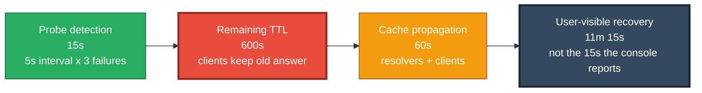

# failover-budget


Measure what DNS and GSLB failover actually costs, in the only unit that matters: what your users experience.

```
visible recovery = probe detection + remaining TTL + cache propagation
```

Most teams believe their failover takes thirty seconds because the load balancer console says so. The console measures the appliance decision. Users experience probe interval times failure threshold, plus worst-case remaining DNS TTL, plus resolver and client cache propagation. This tool adds the terms up.

## The equation



The TTL term dominates in most environments. That is the term that decides whether your failover is a continuity strategy or an outage with a label on it.

## Operator runbook

The tool includes a built-in operator runbook with step-by-step commands:

`ash
failover-budget --runbook     # full step-by-step guide with dig, curl, tcpdump, HAProxy
failover-budget --diagnose    # symptom-based decision tree for a failing failover
`

The runbook covers:
- What DNS is actually returning (dig)
- What the resolver thinks the TTL is (dig @resolver)
- Whether the application is responding (curl)
- Whether traffic is flowing (tcpdump)
- Whether the health check is lying (HAProxy logs)
- How to calculate the budget (failover-budget)
- How to run the drill (5 steps)
- Common mistakes and how to avoid them


Python 3.9+, no dependencies.

## Install and run

### Option 1: single file, no Python (Windows)

Download `failover-budget.exe` from the releases page and run it directly.

```
failover-budget.exe --probe-interval 5 --fall-threshold 3 --ttl 600 --cache-propagation 60
```

**Double-click it** and it runs in interactive mode: it asks for your probe interval, fall threshold, TTL, cache propagation and target, prints the budget, and waits for you to press Enter before closing. Nothing to type, nothing to install.

**Windows may show "Windows protected your PC" or "unknown publisher".** This binary is not code signed, so Windows SmartScreen cannot verify it. Click **More info**, then **Run anyway**. To check the file before you run it, compare the SHA256 in the release notes, or run the source version below instead.

To build it yourself from source:

```
build_windows.bat
```

### Option 2: from source

```bash
git clone https://github.com/rahmankhanjohn/failover-budget.git
cd failover-budget
python3 failover_budget.py --probe-interval 5 --fall-threshold 3 --ttl 600 --cache-propagation 60
```

On Windows the launcher is `py` if `python` is not on your path:

```
py failover_budget.py --ttl 600
```

Running the source version with no arguments also gives you the interactive prompt.

### Option 3: no install, one line

```
python -c "import urllib.request;exec(urllib.request.urlopen('https://raw.githubusercontent.com/rahmankhanjohn/failover-budget/main/failover_budget.py').read())" --ttl 600
```

## Measuring the real cache hold

The third term is the one people guess. This tool measures it instead, using a minimal DNS client over UDP (still no dependencies).

```
failover-budget.exe --measure-cache www.microsoft.com
```

```
Cache hold measurement
==============================================================
  Target        www.microsoft.com
  Resolver      192.168.1.1
  Declared TTL  12 seconds
  Observed hold  13s
  Cache propagation term  1s  (hold minus declared TTL)
  Samples       5
  Note          cache entry expired and was re-fetched
```

**How it works.** TTLs decay while an answer is cached. When the entry expires, the resolver re-fetches and the TTL jumps back up. That moment is the cache hold. Hold minus declared TTL is the propagation term the budget needs.

**Pick a target with a short TTL.** The measurement has to run past the TTL to see the reset, so a 300 second record means a 5 minute wait. `www.microsoft.com` (about 12s) or `api.github.com` (about 50s) give a complete result quickly. Use a record that resembles your own traffic if you want a representative number.

**The tool knows when the measurement is lying.** An anycast public resolver can return a reset that arrived before the declared TTL could possibly have elapsed. That is an edge change, not a real expiry. The tool flags it as unreliable and keeps your default cache term instead of using the bogus number. A result that says "suspicious reset at 6s, below the declared TTL of 15" is the tool doing its job.

**Measure from the network you care about.** Run it on a client site, a VPS in your region, or against the resolver your users actually use. Your resolver is not their resolver. Public resolvers are anycast: 8.8.8.8 and 1.1.1.1 answer from different edges with independent cache state, so consecutive queries can look like a reset that never happened. Measure against a single instance, your own router, your corporate DNS, or your ISP resolver.

**Resolvers.** By default the tool uses the resolvers configured on this machine, then falls back to public ones. Force one with `--resolver 192.168.1.1` or a comma separated list.

**In interactive mode** the calculator offers to measure the cache hold before computing the budget, and uses the measured value as the third term.

## Usage

```bash
$ python3 failover_budget.py --probe-interval 5 --fall-threshold 3 --ttl 600 --cache-propagation 60
```

```
Failover budget
==============================================================
  Probe detection        15s    2.0%   5s interval x 3 failures
  Remaining TTL      14m 40s   78.4%   worst case (failure right after cache fill)
  Cache propagation      1m    17.6%   resolvers and clients beyond TTL
--------------------------------------------------------------
  User-visible recovery  15m 55s   target 1m 0s
  Result: OVER TARGET by 14m 55s
Console timestamps measure the appliance decision.
This measures what users experience.
```

Flags:

| Flag | Default | Meaning |
|------|---------|---------|
| `--probe-interval` | 5 | health probe interval, seconds |
| `--fall-threshold` | 3 | consecutive failures before demote |
| `--ttl` | 300 | DNS TTL, worst-case remaining, seconds |
| `--cache-propagation` | 60 | resolver/client caches beyond TTL, seconds |
| `--target` | 60 | recovery target, seconds |
| `--json` | off | machine-readable output |

Exit code 0 = within target, 1 = over target. Script it:

```bash
python3 failover_budget.py --ttl 300 && echo ok || echo "failover budget blown"
```

## What each term means

**Probe detection.** How long before the load balancer notices the failure. Probe interval times fall threshold. Tune both in the pool monitor config (`inter 5s fall 3 rise 2` is a common shape).

**Remaining TTL.** Worst case is the full TTL: failure strikes just after a resolver cached the answer, and clients keep landing on the dead site until the record expires. Shorten TTL on critical records or accept the budget.

**Cache propagation.** Resolvers and clients that do not honour TTL cleanly, plus positive and negative caching layers you do not control. Measure it with a packet capture after TTL expiry rather than guessing.

## Measuring the real number (the drill)

1. Pick a maintenance window and tell the application team.
2. Power off the primary (or withdraw the route).
3. Run `failover_budget.py` with your configured values alongside a stopwatch.
4. Capture client-side behaviour after TTL expiry (packet capture or synthetic probes from outside your network).
5. Record the real number. File it. Repeat quarterly.

The budget you have never measured is a wish.

## Why this exists

Submitted to bdNOG22, Cox's Bazar, 11-14 November 2026 — *The Failover Budget Equation: Measuring Real DNS and GSLB Recovery Time*.

Anycast solves the TTL half of the equation at BGP convergence speed, but it does not replace health awareness. Whatever your steering mechanism, measure the user-visible number, not the appliance one.

## Tests

```bash
python3 -m unittest test_failover_budget -v
```

## Recognition

Selected for the [XERJ Corpus Hub](https://github.com/xerj-org/xerj) — an open index of reference code solutions that AI coding agents consult before writing their own. The runbook and diagnostic additions (commit f153c59) were indexed as a worked reference for DNS and GSLB failover diagnosis.

## License


MIT
